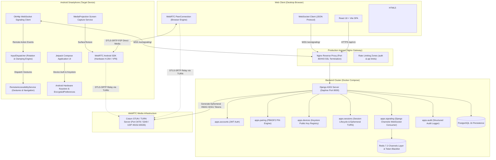

# Final Architecture Specification: Secure Android Remote Control Platform

**Version**: 1.0.0 (Production Release)  
**Date**: November 2026  
**Status**: COMPLETE / PRODUCTION READY  

---

## 1. High-Level System Architecture

The Secure Android Remote Control Platform enables authenticated users to view and interact with their Android smartphones remotely from any standard web browser across heterogeneous networks (NAT, firewall, mobile cellular, and Wi-Fi).



---

## 2. Complete End-to-End Workflow

The entire user lifecycle from installation to remote interaction proceeds through 8 sequential, cryptographically verified steps:

```mermaid
sequenceDiagram
    autonumber
    actor User as Phone Owner
    participant Phone as Android App
    participant PhoneHW as Android Keystore
    participant Backend as Django ASGI Backend
    participant Turn as Coturn Server
    participant Browser as Web Browser Dashboard

    Note over User,PhoneHW: STEP 1: DEVICE INITIALIZATION
    User->>Phone: Install and open application
    Phone->>PhoneHW: Generate EC P-256 Keypair in Hardware TEE
    Phone->>Backend: Register Device (HW Fingerprint, Public Key)
    Backend-->>Phone: Device Token (Stored in EncryptedSharedPreferences)

    Note over Phone,Backend: STEP 2: TEMPORARY PIN PAIRING
    User->>Phone: Tap "Generate Pairing PIN"
    Phone->>Phone: CSPRNG generates "849-201", Salt, PBKDF2 Hash (100k rounds)
    Phone->>Backend: POST /api/v1/pairing/initiate/ (DeviceID, PIN Hash, Salt, TTL=180s)
    Phone-->>User: Displays PIN "849-201" on screen

    Note over Browser,Backend: STEP 3: WEB AUTHENTICATION & PIN SUBMISSION
    User->>Browser: Log in with Email & Password (JWT issued)
    User->>Browser: Enters PIN "849-201"
    Browser->>Backend: POST /api/v1/pairing/verify/ (PIN)
    Backend->>Backend: PBKDF2 verification against active sessions (3 attempt limit)
    Backend-->>Phone: Push WebSocket notification: Pairing Request from Browser

    Note over User,Phone: STEP 4: PHYSICAL CONSENT ON PHONE
    Phone->>User: Displays Fullscreen Consent Dialog with Requester IP & UA
    User->>Phone: Explicitly taps "Approve Connection"
    Phone->>Backend: POST /api/v1/pairing/approve/ (Approved=True)
    Backend->>Backend: Associate Device ownership with User Account (Status: PAIRED)

    Note over Browser,Backend: STEP 5: REMOTE SESSION CREATION & TURN PROVISIONING
    User->>Browser: Clicks "Connect" on Registered Device
    Browser->>Backend: POST /api/v1/sessions/create/ (DeviceID)
    Backend->>Turn: Calculate Ephemeral HMAC-SHA1 Coturn Credentials (TTL=3600s)
    Backend-->>Browser: Session Token & STUN/TURN ICE Configuration

    Note over Browser,Phone: STEP 6: WEBRTC SIGNALING & DTLS-SRTP STREAMING
    Browser->>Backend: WSS /ws/signaling/<session_id>/ (Join)
    Phone->>Backend: WSS /ws/signaling/<session_id>/ (Join)
    User->>Phone: System MediaProjection prompt: "Start now"
    Phone->>Browser: WebRTC SDP Offer (H.264 / VP8) via WebSocket
    Browser->>Phone: WebRTC SDP Answer via WebSocket
    Phone<->Browser: ICE Candidate Trickle Exchange
    Phone-->>Browser: DTLS-SRTP Real-time Screen Video Stream

    Note over Browser,Phone: STEP 7: REMOTE INTERACTION & GESTURE DISPATCH
    User->>Browser: Clicks, drags, scrolls, or types on viewport
    Browser->>Backend: WebSocket: remote_action (TAP, SWIPE, TEXT, BACK, HOME)
    Backend->>Phone: WebSocket relays remote_action
    Phone->>Phone: InputDispatcher translates normalized coords (Clamping & Rotation)
    Phone->>User: RemoteAccessibilityService injects gesture on screen

    Note over Browser,Phone: STEP 8: SESSION TERMINATION
    User->>Phone: Tap "Disconnect" in persistent foreground notification
    Phone->>Backend: WebSocket: session_terminate
    Backend->>Backend: Mark RemoteSession TERMINATED, log AuditEvent
    Browser-->>User: Viewport closes, displays Session Summary
```

---

## 3. Security Boundary & Cryptographic Invariants

```
+───────────────────────────────────────────────────────────────────────────────────────────────────+
| SYSTEM BOUNDARY          | SECURITY MECHANISM                                                     |
+──────────────────────────+────────────────────────────────────────────────────────────────────────+
| User Authentication      | Passwords hashed with PBKDF2/Argon2. JWT short-lived access tokens     |
|                          | (15 min) with refresh token rotation and database blacklist.          |
+──────────────────────────+────────────────────────────────────────────────────────────────────────+
| Device Identity          | Hardware-backed EC P-256 keys generated in Android Keystore (StrongBox |
|                          | / TEE). Ingestion endpoint verifies hardware fingerprint uniqueness.  |
+──────────────────────────+────────────────────────────────────────────────────────────────────────+
| PIN Pairing Security     | Dynamic 6-digit CSPRNG PIN. Active PINs are never stored in plaintext. |
|                          | Enforced 100,000 PBKDF2 rounds, 180s TTL, and permanent 3-attempt     |
|                          | brute-force lockout. Physical on-device approval required.             |
+──────────────────────────+────────────────────────────────────────────────────────────────────────+
| Media Transport          | Mandatory DTLS-SRTP WebRTC peer encryption. Media packets are opaque  |
|                          | to all intermediate routers and relays.                                |
+──────────────────────────+────────────────────────────────────────────────────────────────────────+
| TURN Relay Access        | HMAC-SHA1 dynamic time-window credentials generated by backend.        |
|                          | Frontend never receives long-term Coturn shared secrets.               |
+──────────────────────────+────────────────────────────────────────────────────────────────────────+
| Android OS Boundaries    | MediaProjection user prompt cannot be bypassed. Visible foreground     |
|                          | notification permanently visible during capture. FLAG_SECURE respected.|
+──────────────────────────+────────────────────────────────────────────────────────────────────────+
| Remote Interaction       | Normalized coordinate clamping [0.0, 100.0]. Explicit Accessibility    |
|                          | Service consent. Unsupported system operations strictly documented.   |
+──────────────────────────+────────────────────────────────────────────────────────────────────────+
| Audit Trail              | Tamper-evident AuditLog records all logins, device registrations,      |
|                          | pairing attempts, lockouts, sessions, and client IP/UA metadata.       |
+───────────────────────────────────────────────────────────────────────────────────────────────────+
```

---

## 4. Android Platform Boundaries & Restriction Matrix

The platform operates strictly within documented, public Android APIs without requiring root or ADB debugging:

| Android Feature | Supported / Permitted | System Restriction / Boundary |
| :--- | :--- | :--- |
| **Normal Application UI** | **YES** (Full screen mirroring & gestures) | Standard Android view hierarchy |
| **Banking / DRM Apps** | **BLOCKED BY OS** | `FLAG_SECURE` produces a black screen |
| **Keyguard / Lock Screen** | **RESTRICTED** | Cannot bypass PIN/Pattern/Biometric unlock |
| **System Permission Prompts** | **VIEW ONLY** | Android blocks accessibility clicks on permission dialogs |
| **Notification Shade** | **YES** | Expanded via `GLOBAL_ACTION_NOTIFICATIONS` |
| **Power Dialog / Reboot** | **RESTRICTED** | Cannot power cycle or force reboot without root |
| **Audio Capture** | **OPTIONAL** | MediaProjection internal audio capture requires Android 10+ |

---

## 5. Summary of Completed Project Phases

| Phase | Milestone Title | Primary Deliverables | Status |
| :---: | :--- | :--- | :---: |
| **1** | Architecture & Android Foundation | System architecture, DB schema, Compose UI, Keystore, Services | **COMPLETED & VERIFIED** |
| **2** | Backend & Secure Device Pairing | Django DRF, JWT Auth, PBKDF2 PIN pairing, WebSocket signaling | **COMPLETED & VERIFIED** |
| **3** | WebRTC Screen Mirroring | Android MediaProjection WebRTC, React SPA, Coturn STUN/TURN | **COMPLETED & VERIFIED** |
| **4** | Remote Control Implementation | Gesture injection, InputDispatcher, Rotation, Action Matrix | **COMPLETED & VERIFIED** |
| **5** | Security, Optimization & Deploy | Security audit, Docker Compose, Nginx SSL, ProGuard release | **COMPLETED & VERIFIED** |
